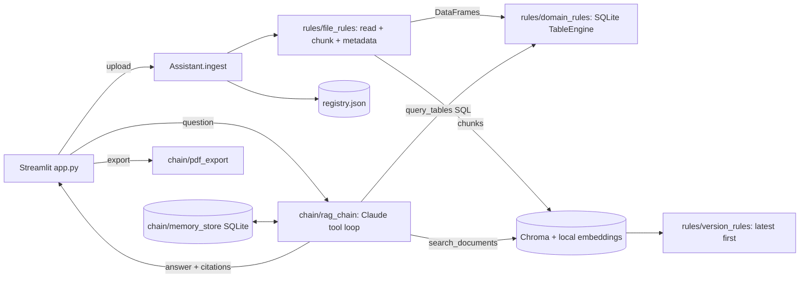

# VoltKart multi-source RAG assistant (core scope)

Chat over uploaded CSV / XLSX tables and PDF / DOCX / TXT documents, with a citation for every fact.
**Scope: all core requirements plus the three bonus features** - web-search toggle, multiple chats, charts.

## Setup & run
```bash
python -m venv .venv && source .venv/bin/activate
pip install -r requirements.txt
cp .env.example .env        # fill ANTHROPIC_API_KEY (embeddings are local by default)
streamlit run app.py
python -m pytest tests/test_pipeline_steps.py     # offline tests
```
Data (uploads, Chroma index, registry, chat DB) is stored in `./data` (override with `DATA_DIR`) and survives restarts.

## Architecture

Flow: Claude receives history, schema and file list, then calls `query_tables` (SQL, computed by SQLite) and/or
`search_documents`. Each tool result carries a tag (`[T1]`, `[D2]`); the answer must cite them, and the UI shows the
used citations (table + SQL, or file + doc date + page/section + version status).

## How the core requirements are met
| Requirement | Where |
|---|---|
| Chat UI, markdown | `app.py` |
| Upload CSV/PDF/DOCX/TXT/XLSX, listed, later uploads | `app.py`, `Assistant.ingest`, `registry.json` |
| Exact table math over joins | `rules/domain_rules.py` (LLM writes SQL, SQLite computes; `revenue_lines` view applies the Delivered-only, discounted rule) |
| Latest document version wins | `rules/version_rules.py` + `retrieve()` always pulls the newest version of each family; chunks are labelled LATEST/OLDER; prompt requires naming older versions |
| Citations / abstention | `[T#]`/`[D#]` tags in `rag_chain.py`; `check_citations`; fixed "not in the provided sources" phrase |
| Memory across restarts | `chain/memory_store.py` (SQLite) |
| PDF export | `chain/pdf_export.py` (timestamps, tables, citations + SQL) |

Chunk metadata: `source_file, file_type, doc_date, doc_family, kind, page, section, sheet, table, row`.
Nothing is hard-coded to the sample files: join rules apply only when matching columns exist; column names are normalised to snake_case.

## Bonus features
| Feature | How it works |
|---|---|
| Web search toggle | Sidebar toggle, read per message. **Off:** the web tool is never given to the model (and the prompt says so), so it cannot browse. **On:** Anthropic's server-side `web_search` tool is added next to the table/document tools, so one answer can mix web and uploaded data. Web sources are shown as title + URL (`[W1]` entries in Citations) and inline links. Needs web search enabled for your org in the Anthropic Console. Each message stores its web on/off state (shown in the UI and the PDF). |
| Multiple chats | `chats` + `messages` tables in `data/chat.db`. Every history/read/write call is scoped by `chat_id`, so chats cannot leak context. Sidebar: New chat, chat list (first question becomes the title), switch, delete. Uploaded files are shared by all chats. Old single-chat databases are migrated automatically. |
| Charts | Claude calls the `make_chart` tool with a SQL query (first column = labels, other columns = numeric). `chain/charts.py` builds the chart from the query result itself (the LLM never types values) and renders it with matplotlib: bar, line, pie with title and axis labels. The chart carries a normal `[T#]` citation (tables + SQL), is shown inline, saved with the message and included in the PDF export. |

## Evaluation export
Follow the chat layout of the assignment (Chat 1: Q1-5, 15-16, 19; Chat 2: Q6-14, 20; Chat 3: Q17-18), click **Export chat as PDF** in each chat and save as `evaluation/chat1.pdf`, `chat2.pdf`, `chat3.pdf`.

## Known limitations
- Document families are grouped by normalised file name; very different names across versions are not linked (near matches at 0.85 similarity are).
- Date comes from "Document Date"/"Effective Date" in the body, else the file name; dates in other formats are missed.
- Scanned PDFs (no text layer) are not OCR'd; images in documents are ignored.
- Text-to-SQL can still pick wrong columns/filters; the SQL is shown in the citation so it can be checked.
- PDF export uses built-in fonts: unsupported characters become `?` (the rupee sign is written as "Rs.").
- Row-level chunks of big tables are embedded (cost/time grows with row count); aggregate questions use SQL only.
- No streaming (full answers are shown when ready).
- Charts: at most 40 categories; a month with no rows is missing from a line chart unless the SQL generates it (the prompt asks for this, but check).
- Web answers depend on what the search returns; web facts are only as reliable as their sources.

## Embeddings
`EMBEDDINGS=local` (default) uses chromadb's bundled MiniLM model (free, ~80 MB one-time download). `EMBEDDINGS=openai` uses OpenAI (needs `pip install langchain-openai` and `OPENAI_API_KEY`). Switching providers changes vector size: delete the `data/` folder and re-upload.
